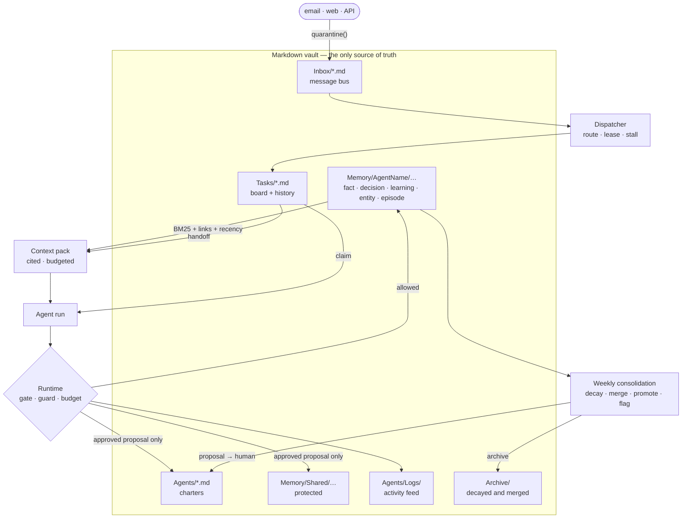

# agent-os — a second brain for an AI-native operation

[](https://github.com/gladkiandrew/agent-os/actions/workflows/tests.yml)


A crew of AI agents is only as good as what it remembers and how well it shares the
work. agent-os gives a crew **one memory that compounds**: typed markdown notes with
provenance, retrieval with citations, a weekly consolidation that turns repeated
lessons into charter-level insight. It also gives the crew **coordination**: a task
board with leases, handoffs that carry context, and a message bus that treats every
message as data. All of it sits on a **fail-closed governance layer**, where nothing
writes anywhere without passing the same guard, gate and audit feed.

```bash
git clone https://github.com/gladkiandrew/agent-os && cd agent-os
python -m agent_os.demo_brain                # 3 simulated days, 4 agents: no keys, no network, ~0.1s
python -m unittest discover -s tests         # 80 tests
```

## Architecture



Memory, board and bus are **callers** of the runtime, never alternatives to it. A new
capability can't be a new way in.

## How a run works

```
claim T-0001 ─► context pack ─► act ─► write back ─► handoff ─► retro ─► release
   lease         handoff first,   mock    facts,        next owner    worked /    lease
   expires if    then cited       model   learning,     gets it in    failed /    dropped
   no heartbeat  notes, ≤ budget  (or a   episode       their pack    next
                 externals        real    citing what   first
                 quarantined      one)    it relied on
```

Every arrow is a feed line. The episode links every note the pack cited, and that link
is what a citation *is*. When later runs keep relying on a learning, consolidation
proposes promoting it into the owner's charter, and a human approves. That loop is the
compounding.

## From the demo

A fictional four-agent crew (Captain, Researcher, Writer, Reviewer) runs a fictional
bakery-supply business on a fake clock. Abridged from
[`tests/golden/demo_brain.txt`](tests/golden/demo_brain.txt), which CI diffs byte for byte:

```
Day 1 — a capture becomes work, and knowledge moves between agents
  Mon 09:00  Dispatcher: promoted M-0001 → T-0001; T-0001 → Researcher
  Mon 09:20  ✗ Writer tried to claim T-0001: T-0001 is routed to Researcher
  Mon 09:20  ✓ Researcher: context pack 4 notes (1 quarantined), wrote millstone-flour-delivers-…, small-suppliers-confirm-slots-faster-by-phone
  Mon 10:30  ✓ Writer's pack opens with handoff [[handoff-t-0001-researcher]] and cites …

Day 2 — a crashed claim expires; an email that gives orders is parked
  Tue 11:30  Dispatcher: parked M-0003 (override-attempt, payment-request); expired Writer's lease on T-0002, re-routed → Writer
  Tue 12:00  tasks on the board: T-0001 done, T-0002 done (the parked email never became a task)

Day 3 — the weekly consolidation
  Wed 09:00  archived Memory/Captain/episode/ep-september-stocktake.md (decayed: uncited episode older than 14d)
  Wed 09:00  merged [[writer-small-suppliers-confirm-slots-faster-by]] into [[small-suppliers-confirm-slots-faster-by-phone]]
  Wed 09:00  FLAG delivery-day: delivery-day says Tuesday vs move-deliveries-to-thursday-for-oakridge says Thursday → a human decides
  Wed 09:00  proposed #1: promote [[small-suppliers-confirm-slots-faster-by-phone]] into Agents/Researcher.md
  Wed 09:00  ✓ human approved #1
```

## The rules, and the tests that hold them

| Rule | Where | Failure case under test |
|---|---|---|
| Every note has provenance; `stated` needs a human source | `memory/note.py` | a sourceless write is rejected and logged |
| Confidence only ratchets up: `stated > observed > inferred` | `memory/store.py` | an inferred note can't overwrite a stated one |
| Shared memory and charters change only by approved proposal, pinned to the exact bytes | `coord/proposals.py` | no self-approval; a charter proposal can't touch permissions |
| Retrieval cites `note id + line`; packs never exceed their budget | `memory/search.py`, `memory/context.py` | every item cited at budgets from 180 to 5,000 chars |
| A claim is a lease; two agents can't hold one | `coord/board.py` | 4 threads race for one task, exactly one wins |
| A dead agent's lease expires and the work is re-routed | `coord/dispatcher.py` | fake clock, no heartbeat → released |
| Messages are data; a flagged one never becomes a task | `coord/bus.py` | an injection attempt is parked, not promoted |
| Consolidation is deterministic and only *proposes* | `memory/consolidate.py` | two runs produce identical vaults |

The governance layer underneath is unchanged from v0.1 and still covered by its own 32 tests:

| Piece | Rule |
|---|---|
| **Charters** | One markdown file per agent; anything its frontmatter doesn't declare is denied. |
| **Write-scope guard** | Fail-closed: unknown agent, pending charter, `..` or symlink escape, out-of-scope path. `*` never crosses a `/`. |
| **Action gate** | Spend, outbound, publish, deploy and secrets always go to a human queue. |
| **Budget** | Monthly cap per agent; a charge that would cross it is refused whole. |
| **Activity feed** | One line per action, blocked attempts included. No feed line, it didn't happen. |
| **Quarantine** | Ingested text is data; text that tries to give orders is flagged. |

## Where this applies

- **Agencies:** a crew drafting, researching and reporting across clients, where a
  lesson from one engagement should reach the next without anyone re-explaining it.
- **Small ops teams:** recurring work (suppliers, scheduling, notices) where the
  record of *why* matters as much as the output.
- **Deal teams:** screening and diligence where every figure needs a source and a
  claim from a teaser must never overwrite a verified number.
- **Research desks:** analysts and agents sharing one evidence base, with
  contradictions surfaced instead of silently resolved.

## What's real and what's reference

- **Real: the design.** I run my agency with a crew of chartered agents working in a
  markdown vault: the vault as source of truth, logs that decay while insights
  compound, a weekly consolidation, a heartbeat dispatcher, human approval for
  anything that leaves the building. Those rules are the ones in this repo.
- **Reference: the code and the data.** Everything here is written fresh and generic.
  My production setup runs on Claude Code hooks and private repositories with real
  charters, prompts and integrations, none of which are here. The bakery is fictional.

The full design, with the data model and the six decisions behind it, is in
[`docs/second-brain.md`](docs/second-brain.md).

## Layout

```
agent_os/
  runtime.py  scope.py  gate.py  budget.py  feed.py  quarantine.py  charter.py   governance (v0.1)
  memory/     note · store · search · context · consolidate                      the second brain
  coord/      board · bus · proposals · dispatcher                               coordination
  brain.py    loop.py    model.py                                                wiring · one run · model seam
  demo.py     demo_brain.py
examples/brain/   the fictional crew and seed vault
tests/            80 tests + golden demo output
```

Python 3.10+, standard library only. Runs keyless against a deterministic mock model.

## Bring your own model

No vendor is assumed. Set `LLM_PROVIDER` (and `LLM_MODEL` where the provider needs it)
and `model_from_env()` returns the matching adapter. Nothing else changes: a real
model's words become inferred notes behind the same guard, never permissions.

| `LLM_PROVIDER` | What it runs | Credential |
|---|---|---|
| `openai` · `xai` · `openrouter` | GPT, Grok, or anything on OpenRouter | `OPENAI_API_KEY` · `XAI_API_KEY` · `OPENROUTER_API_KEY` |
| `ollama` | a local open-weight model | none |
| `openai-compatible` | any `/chat/completions` server (vLLM, LM Studio, …) via `LLM_BASE_URL` | `LLM_API_KEY` if it needs one |
| `command` | any CLI that reads a prompt on stdin, e.g. `LLM_COMMAND="claude -p"` | whatever the CLI uses: a subscription works, no API key |
| `anthropic` | Claude via the Anthropic API (optional `anthropic` package) | `ANTHROPIC_API_KEY` |

I run my own crew through Claude Code on a Claude Max subscription, which is the
`command` path. The OpenAI-compatible and command adapters are standard library;
the tests and demos never call a real model.

## Related

- [`armm`](https://github.com/gladkiandrew/armm): my risk-first crypto futures execution engine, same philosophy: deterministic guards, demo lock by construction, everything logged.
- [`amagna-intelligence`](https://github.com/gladkiandrew/amagna-intelligence): the companion TypeScript reference architecture: markdown memory, chartered agents, a Telegram cockpit on Cloudflare, and a PE deal-screener example.

MIT licensed.
