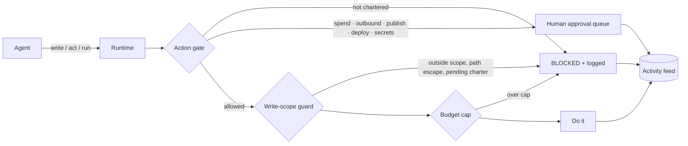

# agent-os — guardrails for a crew of AI agents


I run my agency, Amagna AI, with a crew of chartered AI agents: a captain that
triages and routes, a content agent, an ads and analytics agent, an outreach
agent, a memory and security agent, and a heartbeat dispatcher. They work in a
shared markdown workspace (an Obsidian vault), across Claude Code, scheduled
tasks and a VPS.

The hard part was never getting agents to do things. It was making sure they
**only** do what they're chartered to do, that a human approves anything that
spends money or leaves the building, and that there is a record of every
action. This repo is a public, sanitized version of that governance layer,
rewritten as a small Python package you can run in one command.

```bash
git clone https://github.com/gladkiandrew/agent-os && cd agent-os
python -m agent_os.demo                    # no keys, no network, no model
python -m unittest discover -s tests -v    # 32 tests
```

## How it works



| Piece | Rule |
|---|---|
| **Charters** (`charter.py`) | One markdown file per agent is the single source of truth. Frontmatter declares status, write scope, allowed actions and budget. Anything not declared is denied. |
| **Write-scope guard** (`scope.py`) | Fail-closed. Unknown agent, pending charter, absolute path, `..` escape, symlink escape or out-of-scope path all refuse. `*` never crosses a `/`. |
| **Action gate** (`gate.py`) | Spend, outbound, publish, deploy and secrets **always** go to a human queue. A charter can let an agent *request* them, never *do* them. |
| **Budget** (`budget.py`) | Monthly cap per agent. A charge that would cross it is refused whole. |
| **Activity feed** (`feed.py`) | One line per action in `Agents/Logs/YYYY-MM-DD.md`, blocked attempts included. If there's no feed line, it didn't happen. Every run ends with a `worked / failed / next` retro. |
| **Quarantine** (`quarantine.py`) | Anything ingested from outside is data, never instructions. Text that tries to give orders is flagged so the router parks it for a human. |
| **Dispatcher** (`dispatcher.py`) | The heartbeat. Promotes inbox captures to tasks, parks suspicious ones, escalates anything stuck in `doing` for 24h, and posts one status line only when something changed. Silence means nothing moved. |

## Demo output

```
✓ Writer drafted Content/drafts/launch-post.md
✗ blocked: Writer may not write 'Metrics/q3.md' (scope: ['Content/drafts/*.md'])
✗ blocked: path escapes the workspace: 'Content/drafts/../../../etc/passwd'
⏸ publish filed for approval as request #1
✓ human approved #1
✗ blocked: Scout has no active charter
✗ blocked: Analyst: $6.00 would exceed the $5.00 cap for 2026-10

Dispatcher: promoted 'Draft a recap of the AI summit' → Writer; parked a capture
from web (override-attempt, secret-request); STALL: #1 'Refresh pricing page' (Writer) in doing for 1d+
```

## What's real and what's reference

- **Real:** the design. The rules here (charters as the source of truth, fail-closed
  write scopes, human-only spend/outbound/publish, the feed contract, run retros,
  quarantine of ingested content, a quiet-unless-changed dispatcher) are the ones my
  production crew runs on.
- **Reference:** the code. Production enforcement lives in Claude Code hooks and a
  private repo with real charters, prompts, client data and integrations, none of
  which are here. The example crew (`examples/vault/Agents/`) is generic.

I build with AI coding agents. The architecture, the rules and the tests that hold
the agents to them are mine.

## Stack

Python 3.10+ standard library only · unittest · GitHub Actions. Production runs
across Claude Code, Hermes, MCP tool integrations, Telegram and a Linux VPS.

## Related

- [`armm`](https://github.com/gladkiandrew/armm): my risk-first crypto futures execution engine, same philosophy: deterministic guards, demo lock by construction, everything logged.
- [`amagna-intelligence`](https://github.com/gladkiandrew/amagna-intelligence): the companion TypeScript reference architecture: markdown memory, chartered agents, a Telegram cockpit on Cloudflare, and a PE deal-screener example.
